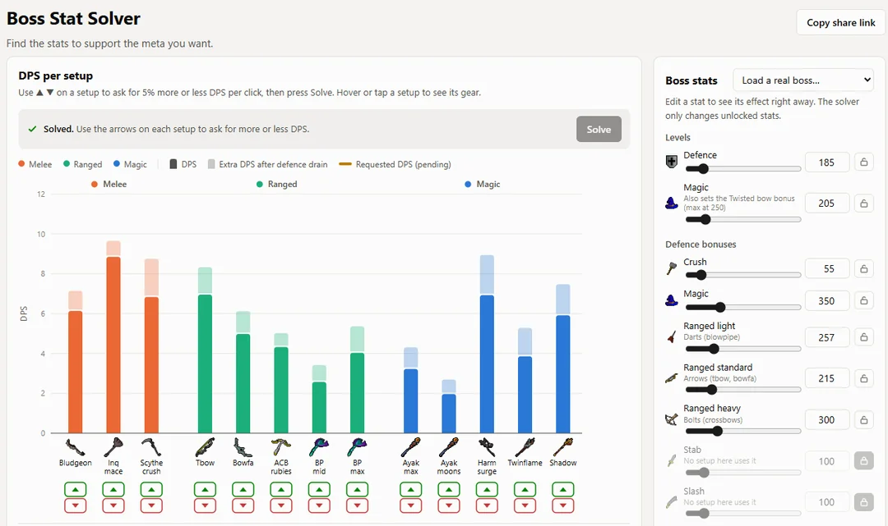

# Boss Stat Solver

**▶ Try it: [sthoresen.github.io/osrs-boss-stat-solver](https://sthoresen.github.io/osrs-boss-stat-solver/)**

[](https://sthoresen.github.io/osrs-boss-stat-solver/)

Nudge OSRS gear setups up or down (±5% DPS per click), press Solve, and the solver finds the boss
stats (defence level, magic level, defence bonuses, elemental weakness, defence-drain caps) that make
those setups do more or less damage while keeping the rest where they are.

It is a static page (no build step, no dependencies), so it can be hosted on GitHub Pages as-is:
push this folder to a repo, then Settings → Pages → deploy from the `main` branch, root folder.
To run it locally: `python3 tools/serve.py`, then open `http://localhost:8000`. That server turns off
browser caching, so a normal reload picks up edits (with `python3 -m http.server` the browser may keep
stale JS files; use Ctrl+Shift+R there). Opening `index.html` straight from disk does not work, because ES modules
need http.

## Files

| Path | What it is |
|---|---|
| `index.html`, `css/style.css`, `js/app.js` | The page: chart, nudge arrows, gear overlay, stats panel, share links |
| `js/engine.js` | DPS engine: closed-form port of the OSRS Wiki DPS calculator for these setups |
| `js/solver.js` | Differential evolution + integer search over boss stats |
| `data/setups.json` | **The setups and player levels.** Hand-edited; the page loads it at runtime |
| `js/items.js` | Generated item stats, spell max hits and boss presets (do not edit by hand) |
| `js/config.js` | Loads `data/setups.json` (browser and Node) |
| `tools/build_data.py` | Rebuilds `js/items.js` and `img/items/` from a checkout of the wiki calculator |
| `tools/oracle.test.ts`, `tools/verify.mjs` | Checks the engine against the real wiki calculator |

## Changing setups

Edit `data/setups.json` and reload the page. Swapping between items that some setup already uses
needs nothing else. If you add an item no setup used before, the page will tell you it is missing; then:

1. `git clone https://github.com/weirdgloop/osrs-dps-calc` next to this folder.
2. `python3 tools/build_data.py ../osrs-dps-calc` (copies that item's stats into `js/items.js` and its icon into `img/items/`).

Item names and versions are as in the calc's `cdn/json/equipment.json`, written `"Name"` or `"Name|Version"`.

New item mechanics, such as a weapon passive the engine doesn't know yet, need code in `js/engine.js`.

## Verifying against the wiki calculator

```sh
cd ../osrs-dps-calc && node .yarn/releases/yarn-*.cjs install
cp ../osrs-cmb-re/tools/oracle.test.ts src/tests/
# cases.json: an array of {size, def, magic, hp, stab, slash, crush, mdef, light, standard, heavy, severity, dwh, ayak}
SETUPS_JSON=../osrs-cmb-re/data/setups.json ORACLE_CASES=cases.json ORACLE_OUT=oracle.json npx jest src/tests/oracle.test.ts --coverage=false
node ../osrs-cmb-re/tools/verify.mjs oracle.json
```

Last run: 300 random bosses × 13 setups (3,900 DPS values, some with DWH or Eye of Ayak drain applied),
0 mismatches, worst relative error 1.5e-15.

## Credits and licence

Formulas are ported from the [OSRS Wiki DPS calculator](https://github.com/weirdgloop/osrs-dps-calc), and
item data and icons come from it and from the [OSRS Wiki](https://oldschool.runescape.wiki/). That calculator
is GPL-3.0, so this project is GPL-3.0 too (see `LICENSE`). Not affiliated with Jagex.

## How this was made

This project is 100% vibe coded. But I did verify that the numbers are correct :)

The wiki was only queried once, while building it. Visitors never poll the wiki: All the data the page needs is already stored in this repo.
